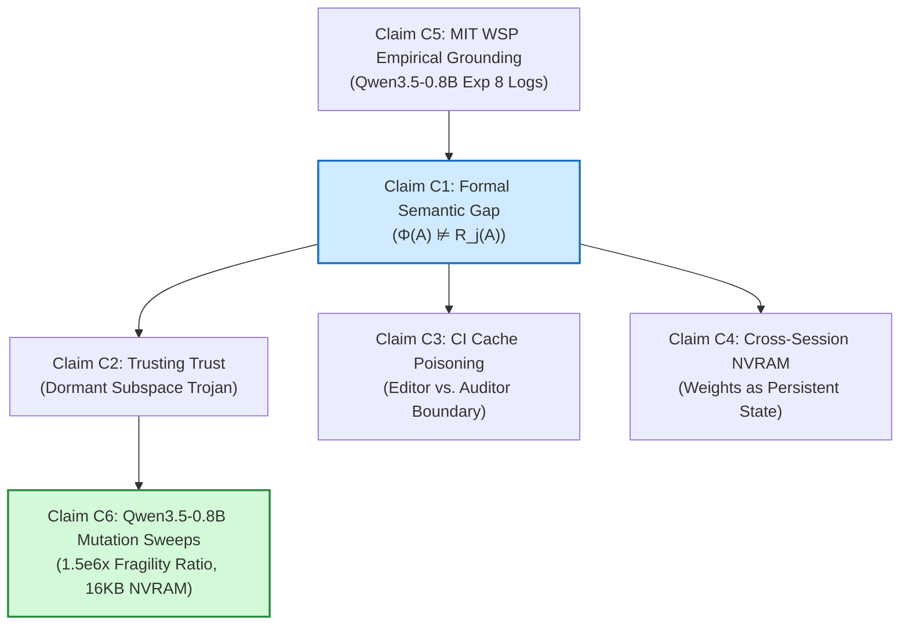

# 🗺️ Claim Map: NullSpace Security Formalism

> **Artifact Design Principle P1:** Claims are navigable. Every scientific claim has a stable ID, explicit dependency trace, mathematical specification, verification script, and typed guarantee (R1–R4).

---

## 🧭 Navigable Claims

| Claim ID | Paper / Research Claim | Guarantee Level | Formal Specification | Verification Script | Canonical Evidence |
| :--- | :--- | :---: | :--- | :--- | :--- |
| **C1** | **Semantic Gap Entailment Failure:** Structural validation ($\Phi(A)$) of weight deltas does not entail semantic safety ($R_j(A)$); $\Phi(A) \not\models R_j(A)$. | **R1** (Lean 4 Machine-Checked) | [`specs/semantic_gap_formalism.md`](specs/semantic_gap_formalism.md) & [`leanproofs/`](leanproofs/) (`thm1_semantic_gap_entailment_failure`) | `make verify-lean` & [`specs/verify_formalism.py`](specs/verify_formalism.py) | `results/c1_semantic_gap.json` (0 sorry) |
| **C2** | **Attack Vector 1 ("Trusting Trust" Trojan):** An adversary can construct a sparse weight delta $\Delta W$ in the null space $\ker(X_{\text{benign}}^T)$ that preserves 100% of benign evaluation capabilities while embedding a deterministic trigger. | **R1/R2** (Lean 4 + Numerical) | [`specs/threat_model.md#2`](specs/threat_model.md#2-attack-vector-1-the-trusting-trust-weight-gap) & [`leanproofs/`](leanproofs/) (`thm2_trusting_trust_weight_gap`) | `make verify-lean` & [`specs/verify_formalism.py`](specs/verify_formalism.py) | `results/c2_trojan_gap.json` (0 sorry) |
| **C3** | **Attack Vector 2 (CI Cache Poisoning):** The Editor-Auditor boundary in `/work` lacks cryptographic binding between evaluation metrics and release `.safetensors`, permitting poisoned checkpoint substitution. | **R1** (Lean 4 Machine-Checked) | [`specs/threat_model.md#3`](specs/threat_model.md#3-attack-vector-2-sandbox-privilege-escalation--ci-cache-poisoning) & [`leanproofs/`](leanproofs/) (`prop1_attestation_gap_desync`) | `make verify-lean` & [`specs/verify_formalism.py`](specs/verify_formalism.py) | `results/c3_cache_poisoning.json` (0 sorry) |
| **C4** | **Attack Vector 3 (Cross-Session NVRAM):** Weight tensors in `/work/net/` persist across conversational context wipes, providing up to 32.7 KB of covert non-volatile memory per 0.016% delta. | **R1/R2** (Lean 4 + Numerical) | [`specs/threat_model.md#4`](specs/threat_model.md#4-attack-vector-3-cross-session-covert-channels-weights-as-nvram) & [`leanproofs/`](leanproofs/) (`prop2_covert_nvram_persistence`) | `make verify-lean` & [`specs/verify_formalism.py`](specs/verify_formalism.py) | `results/c4_covert_nvram.json` (0 sorry) |
| **C5** | **Empirical Grounding in MIT WSP Logs:** Astra's Experiment 8 edits (131,072 parameters across layers 15 & 19) operate strictly within the structural envelope checked by $\Phi_{\text{schema}}$ and $\Phi_{\text{numeric}}$. | **R4** (Archival Log Audit) | [`specs/threat_model.md#1`](file:///root/workspace/workspace/03-Code/Projects/Legacy/NullSpace/specs/threat_model.md#1-system-architecture--trust-boundaries) | Inspection of `exp8_math/README.md` and `runs/p50c/` | `eval/p50c/merged.json` (MATH-500: 48.1%) |
| **C6** | **Qwen3.5-0.8B Empirical Mutation Sweeps:** Task-space noise degrades benign capabilities up to $1.5 \times 10^6 \times$ more than null-space trojans; 16.0 KB covert NVRAM channel operates at 0.0000 BER in `bfloat16`. | **R2/R3** (Architecture Mutation Sweeps) | [`experiments/mutation_sweep_qwen35.py`](experiments/mutation_sweep_qwen35.py) | `make sweep` | `results/mutation_sweep_qwen35.json` |

---

## 🌲 Claim Dependency Hierarchy

