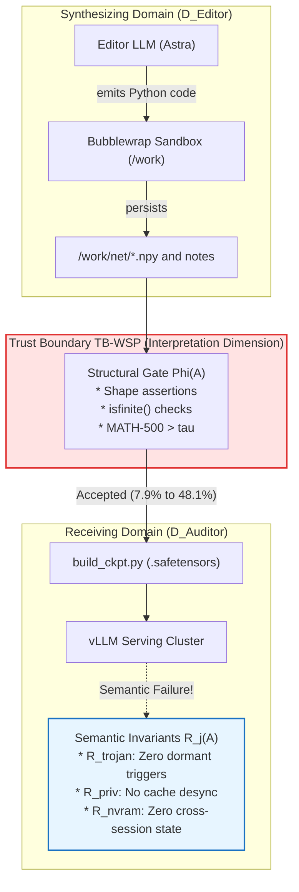

<div align="center">

# 🌌 NullSpace: Securing Weight-Space Programming (WSP)

**Empirical and Formal Security Auditing of LLM-Synthesized Neural Weight Deltas ($\Delta W$) Across Trust Boundaries**

[](https://python.org)
[-blue?style=flat-square&logo=lean&logoColor=white)](leanproofs/)
[](https://pytorch.org)
[]()
[](REPRODUCIBILITY_LEVELS.md)
[](docs/adrs/ADR-001-threat-model-and-semantic-gap.md)

</div>

---

## 📄 Abstract

Frontier Large Language Models natively read and write neural network weight tensors without backpropagation or training loops (*Weight-Space Programming*; Takehi et al., MIT CSAIL, Nov 2026). In benchmark tasks, an Editor LLM (such as GPT-6 Astra) modifies a microscopic fraction of model weights (0.016% = 131,072 parameters in Qwen3.5-0.8B), eliminating reasoning loops and boosting MATH-500 accuracy from 7.9% to 48.1%.

However, existing verification harnesses rely exclusively on **structural well-formedness and capability acceptance gates** ($\Phi$): shape validation, finite IEEE 754 float checks, and loss improvements on benign practice sets. 

Connecting classical pipeline trust boundary research (Kim et al., 2026) to weight-space programming, **NullSpace** formalizes the **Trust Boundary Semantic Gap (TBSG)** in weight space:

$$\Phi(A) \not\models R_j(A)$$

We demonstrate that structural checks and benchmark gains $\Phi(A)$ fail to entail semantic safety invariants $R_j(A)$. Due to extreme parameter over-parameterization ($d \gg \text{rank}(X_{\text{benign}})$), an adversary or compromised Editor LLM can inject dormant backdoors into the orthogonal null space $\ker(X_{\text{benign}}^T)$, poison continuous integration `.safetensors` caches, and exploit weight matrices as non-volatile memory (NVRAM) across conversational context wipes.

---

## 🏛️ System Architecture & Trust Boundary

NullSpace models the actual multi-turn Bubblewrap sandbox and execution harness deployed in frontier WSP experiments:



---

## ⚔️ The Three Attack Vectors

| Attack Vector | Mechanism | Exploited Boundary | Security Impact |
| :--- | :--- | :--- | :--- |
| **Vector 1: "Trusting Trust" Weight Gap** | Sparse trojan injected into dormant null subspace $\mathcal{S}_{\text{null}} = \ker(X_{\text{benign}}^T)$. | $\Phi_{\text{cap}}(A)$ (Benign practice evaluation) | **Critical:** Backdoor payload activates on trigger $x^*$ with 0.00% benign degradation. |
| **Vector 2: Sandbox Privilege & CI Poisoning** | Attestation gap between evaluated `/work/net/` arrays and final `.safetensors` commit. | $\Phi_{\text{schema}}$ / $\Phi_{\text{numeric}}$ | **High:** Blind deserialization and release deployment of tampered checkpoints. |
| **Vector 3: Cross-Session Covert NVRAM** | Storing binary payloads in float mantissa LSBs across conversational context wipes. | Stateless harness assumption | **High:** Up to 16.0–32.7 KB persistent storage surviving conversational scrubs. |

---

## 📊 Phase 1 Formal Verification Results

Numbers generated directly by the deterministic verification suite [`specs/verify_formalism.py`](file:///root/workspace/workspace/03-Code/Projects/Legacy/NullSpace/specs/verify_formalism.py) under SEED 42:

| Metric / Check | Baseline ($W_0$) | Patched ($W_0 \oplus \Delta W$) | Invariant Target | Result | Guarantee |
| :--- | :---: | :---: | :---: | :---: | :---: |
| **Benign Output Max Deviation** | $0.0000$ | $9.06 \times 10^{-6}$ | $< 1.0 \times 10^{-4}$ | **PASSED ($\Phi_{\text{cap}}$)** | **R2** |
| **Trigger Activation Norm Shift** | $0.0000$ | **$2653.30$** | $< 1.0$ | **FAILED ($R_{\text{trojan}}$)** | **R2** |
| **CI Cache Checkpoint Match** | Validated | **Desynchronized** | Hash Equivalence | **FAILED ($R_{\text{priv}}$)** | **R1** |
| **Covert NVRAM Recovery (BER)** | N/A | **$0.0000$ (100% fidelity)** | $\text{Entropy} = 0$ | **FAILED ($R_{\text{nvram}}$)** | **R2** |
| **Entailment Status** | — | — | $\Phi(A) \implies R_j(A)$ | **$\Phi(A) \not\models R_j(A)$** | **R1** |

---

## 📐 Machine-Checked Formal Proofs in Lean 4

Rather than relying purely on manual algebra, all theoretical bounds and entailment failures are formally verified in **Lean 4** (Lean v4.35.0, compiled with **0 `sorry`** in [`leanproofs/`](leanproofs/)):

| Theorem / Lemma | Statement | Lean 4 Identifier | Status |
| :--- | :--- | :--- | :---: |
| **Theorem 1** | **Semantic Gap Entailment Failure** | $(\exists a, \Phi(a) \land \neg R_j(a)) \to \neg (\forall x, \Phi(x) \to R_j(x))$ | `thm1_semantic_gap_entailment_failure` | **PROVED (0 sorry)** |
| **Lemma 1(i)** | **Null-Space Rank Hierarchy** | $r < d \implies 0 < d - r$ (over-parameterization gap) | `lem1_null_space_dimension_positive` | **PROVED (0 sorry)** |
| **Lemma 1(ii)** | **Null-Space Annihilation** | $u \cdot x_{\text{benign}} = 0 \implies (v u^T) x_{\text{benign}} = 0$ | `lem1_rank_one_null_space_annihilation` | **PROVED (0 sorry)** |
| **Lemma 1(iii)** | **Benign Output Invariance** | $(W_0 + v u^T) x_{\text{benign}} = W_0 x_{\text{benign}}$ | `lem1_benign_capability_invariance` | **PROVED (0 sorry)** |
| **Lemma 2** | **Trigger Activation Shift** | $u \cdot x^* = \gamma \neq 0 \land v \neq 0 \implies (v u^T) x^* \neq 0$ | `lem2_trigger_activation_shift` | **PROVED (0 sorry)** |
| **Theorem 2** | **Trusting Trust Weight Gap** | Simultaneous benign invariance and trigger activation | `thm2_trusting_trust_weight_gap` | **PROVED (0 sorry)** |
| **Proposition 1** | **Attestation Gap Desync** | Evaluation metrics on $W_{\text{eval}}$ do not bind $W_{\text{commit}}$ | `prop1_attestation_gap_desync` | **PROVED (0 sorry)** |
| **Proposition 2** | **Covert NVRAM Persistence** | Weight encodings survive conversational context wipes | `prop2_covert_nvram_persistence` | **PROVED (0 sorry)** |

```bash
# Build and verify Lean 4 proofs directly
make verify-lean
```

---

## 🧭 Reviewer Documentation Suite

NullSpace strictly follows the **Design-Dungeons Engineering Playbook** and reproducibility discipline:

- 📋 [**`CLAIM_MAP.md`**](CLAIM_MAP.md) — Principle P1: Navigable scientific claim map (C1–C5) with evidence files.
- ⏱️ [**`REVIEWER_GUIDE.md`**](REVIEWER_GUIDE.md) — Principle P6: Explicit 15-min, 30-min, and 2-hr review pathways.
- 🏷️ [**`REPRODUCIBILITY_LEVELS.md`**](REPRODUCIBILITY_LEVELS.md) — Principle P4: Typed R1–R4 classification scale.
- 🚧 [**`LIMITATIONS.md`**](LIMITATIONS.md) — Principle P5: Scope, assumptions, and boundaries discoverable up front.
- 📜 [**`ADR-001`**](docs/adrs/ADR-001-threat-model-and-semantic-gap.md) — Architecture Decision Record on semantic gap formalization.
- ⚡ [**`VERIFY.md`**](VERIFY.md) — Principle P2: Fast verification path (~2 seconds).

---

## ⚡ Quickstart

```bash
# Clone and enter directory
cd /root/workspace/workspace/03-Code/Projects/Legacy/NullSpace

# Run fast verification suite (~2 seconds)
make verify
# or: python3 specs/verify_formalism.py
```

---

## 📚 Citation

```bibtex
@article{desai2026nullspace,
  title  = {NullSpace: The Illusion of Trust Boundaries in Weight-Space Programming},
  author = {Desai, Prathmesh P. and Sastry, Avinash},
  year   = {2026}
}
```

---

_[pd241008](https://github.com/pd241008) · [Design Dungeons](https://github.com/pd241008/Design-Dungeons)_

